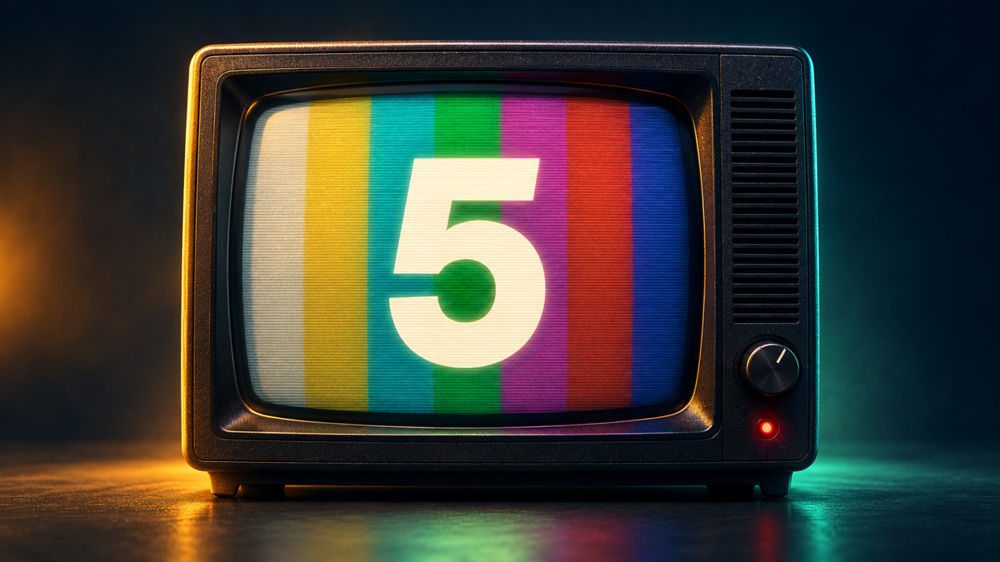
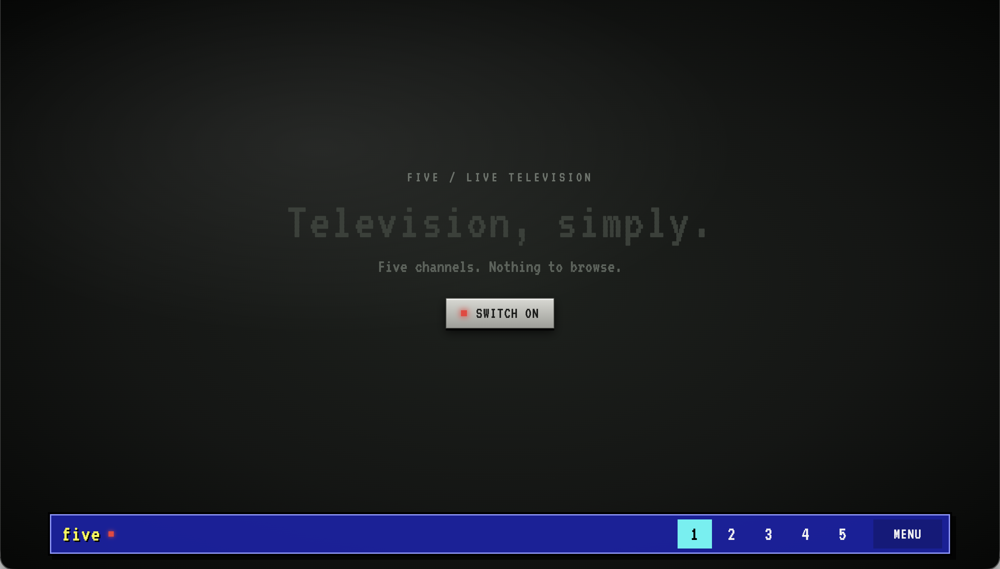
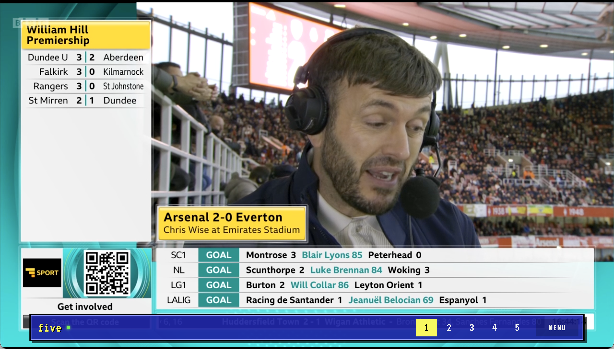
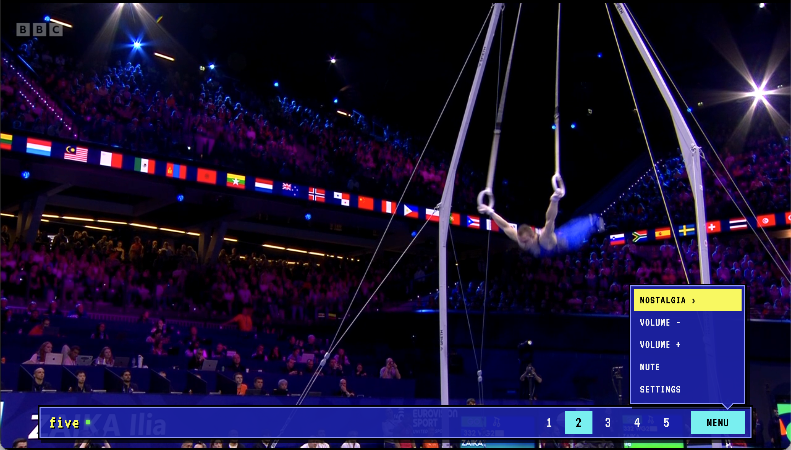

# Five for Fire TV

> A little of what television used to feel like.

I grew up with four television channels. You switched on the TV, pressed a number on the remote, and watched whatever was on.

You might not know what you were watching, when it had started, or what would come next. Without a listings magazine, you discovered it as you went. There was something lovely about that mystery.

Five brings back that feeling with five familiar UK channels. No programme guide, recommendations, or endless catalogue—just a handful of channels and a remote.

## Why simplicity matters

Today, reaching a programme can mean finding your way through apps, accounts, subscriptions, recommendations, and menus. That can be frustrating for anyone. For older people, particularly those experiencing cognitive decline, it can turn a familiar pleasure into something difficult to do alone.

Watching television shouldn’t require constantly learning a new interface. Five keeps the choices small and familiar: press a number, change the channel, watch. A family member or trusted helper can take care of the setup, leaving the everyday experience simple.

## About the app

Five is a deliberately simple live TV app for Android-based Fire TV devices, with five numbered channel choices and controls designed for a physical remote. An optional Nostalgia section brings together selected UK archive clips and advert compilations.

It is shaped by nostalgia and a practical wish to make television easier to use. It is not a medical product, and its accessibility has not yet been formally evaluated.

Five simplifies the viewing experience. It does not uninstall or disable Fire OS apps.

## Channels

| Key | Channel | What happens |
| --- | --- | --- |
| 1 | BBC One | Plays in Five |
| 2 | BBC Two | Plays in Five |
| 3 | ITV1 | Opens the ITVX app on the Fire TV |
| 4 | Channel 4 | Plays in Five; needs the local helper |
| 5 | Channel 5 | Plays in Five; needs the local helper |

The helper can run on an always-on Raspberry Pi or Linux computer. ADB reverse connects the Fire TV to it without exposing the helper to the home network. The helper and tunnel must be running for channels 4 and 5; channels 1–3 do not depend on them. ITVX must be installed on the Fire TV.

## Install

For the full build, ADB install, and optional Raspberry Pi setup, follow [the Fire TV setup guide](firetv/README.md).

In brief: enable ADB debugging on the Fire TV, build and install the APK, start `local-helper/server.mjs` on an always-on machine, and run `scripts/connect-fire-tv.sh <device-serial> --launch` on that same machine. If ADB reconnects or restarts, run the script again to restore the tunnel.

### Ask an AI agent

The easiest way to set it up is to put your computer and Fire TV on the same Wi-Fi, enable ADB debugging on the Fire TV, and open this repository in an AI agent with terminal access. The agent can build and install the app, then help connect the helper for channels 4 and 5. Ask it to:

> Read `README.md` and `firetv/README.md`, then help me install Five on my Android-based Fire TV. Check the available build tools, enable/connect ADB with my help, build and install the APK, and launch it. For channels 4 and 5, check whether the local helper already runs on an always-on machine; if not, help me set it up and keep the ADB reverse tunnel available. Verify the channels and remote controls. Ask me for any device details you need, and never put passwords or private device details in the repository.

If the agent cannot access the Fire TV or terminal, it can guide you through the commands in [`firetv/README.md`](firetv/README.md).

## Controls

- Press **1–5** to select a channel.
- Use **Up/Down** and **Select** to navigate the menu and Nostalgia choices.
- Press **Back** to leave Five or return from ITVX.

## Status and compatibility

Five is a working app that has been tested on two Fire TV Sticks, including playback through the Raspberry Pi helper. Broadcaster streams can change, and other models still need testing.

Five is an Android APK for Fire OS. It will not run on Fire TV devices with Vega OS, including the **Fire TV Stick 4K Select (2025)** and newer **Fire TV Stick HD (2nd gen, 2026)** and **Fire TV Stick 4K (3rd gen, 2026)** models. Check the device’s operating system before buying; Amazon’s [Fire TV device specifications](https://developer.amazon.com/docs/fire-tv/device-specifications-fire-tv-streaming-media-player.html) list the OS by model. Roku is not supported either.

## Screenshots

## License

This repository has no blanket license for reuse. Notices for bundled hls.js and dash.js are in [`third-party-licenses/`](third-party-licenses/). Broadcaster streams and YouTube videos remain subject to their providers' terms.
